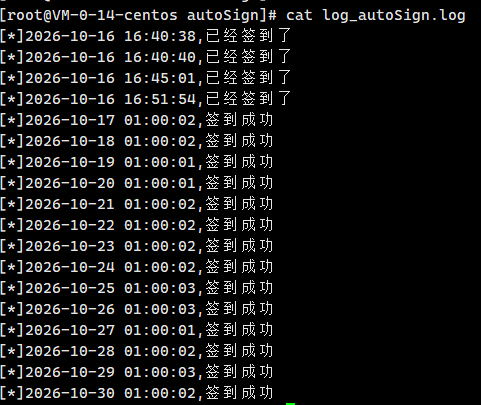

# T00ls 自动签到脚本

这是一个用于自动执行 T00ls 站点签到流程的 Python 脚本。脚本会模拟登录、获取 formhash、提交签到请求，并记录签到结果到日志文件中。

## 功能概览

- 自动登录 T00ls
- 对密码执行 MD5 加密
- 处理 Cookie 和登录状态
- 获取签到所需的 formhash
- 发送签到请求并判断签到状态
- 记录成功、已签到、失败等日志

## 适用场景

- 需要定时签到的账号
- 想自动化完成 T00ls 站点的签到流程
- 适合在服务器、Linux 环境中定时执行

## 环境要求

请确保环境中已安装：

- Python 3.x
- Node.js（因为脚本使用 `execjs` 调用 JavaScript 代码实现 MD5）

安装依赖：

```bash
pip install requests execjs
```

## 文件结构

```text
/workspaces/t00ls_autoSign/
├── autoSign_t00ls.py   # 主脚本
├── README.md           # 项目说明
└── /root/autoSign/
    └── log_autoSign.log  # 签到日志文件（脚本运行时生成）
```

> 注意：当前脚本默认日志路径为 `/root/autoSign/log_autoSign.log`，运行前请先创建目录。

## 使用方法


### 1. 创建日志目录

```bash
mkdir -p /root/autoSign
```

### 2. 运行脚本

```bash
python3 autoSign_t00ls.py <account> <password> <questionid> <answer>
```

### 3. 示例

```bash
python3 autoSign_t00ls.py my_user123 my_password123 2 hello_world
```
### 4.定时启动
```bash
0 9 * * * /usr/bin/python3 /root/autoSign/auto_sign.py > /root/autoSign/run_log.txt
```
其中：

- `account`：账号
- `password`：密码
- `questionid`：安全问题 ID
- `answer`：安全问题答案
建议配合crontab一起使用
## 参数说明

| 参数 | 说明 | 示例 |
| --- | --- | --- |
| `account` | 登录用户名 | `test_user` |
| `password` | 登录密码 | `secret_pass` |
| `questionid` | 验证问题 ID | `0` 或 `2` |
| `answer` | 验证问题答案 | `hello_world` |

## 运行流程

脚本执行时会依次完成：

1. 读取命令行参数
2. 调用 JavaScript MD5 算法对密码进行加密
3. 提交登录请求
4. 获取登录后的 Cookie
5. 请求 `checklogin.html` 读取 `formhash`
6. 向签到接口发送签到请求
7. 根据返回结果写入日志

## 日志输出

脚本会把签到状态写入 `/root/autoSign/log_autoSign.log`。

常见日志内容包括：

- `签到成功`
- `已经签到了`
- `签到失败`

例如：

```text
[*]2026-10-30 12:00:00,签到成功
[*]2026-10-30 12:00:00,已经签到了
```
## 签到日志截图


## 注意事项

- 该脚本依赖目标站点的页面结构和接口字段，页面发生调整时可能失效。
- 请勿将脚本用于破坏、滥用或违反站点使用规则的行为。
- 由于 `execjs` 依赖 Node.js，请确保本机已安装并可用。
- 若站点要求的参数字段或登录流程发生变化，可能需要同步更新脚本逻辑。

## 免责声明

本项目仅用于学习、自动化测试和合法的个人使用场景。使用者应自行确认是否符合目标站点的服务条款和相关规定。

## 维护建议

如果需要长期稳定运行，建议：

- 增加异常捕获和重试机制
- 将日志保存到更规范的目录
- 支持配置文件读取账号和密码
- 增加定时任务（如 cron）